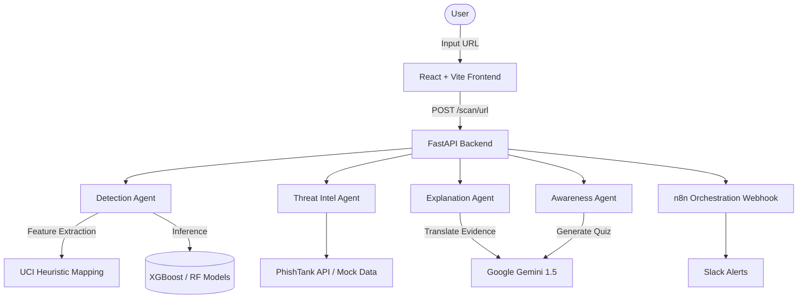

# PHISHSENSE

**Explainable Multi-Agent Phishing & Scam Detection with Personalized Awareness Training**

PHISHSENSE is a hackathon-scoped, technically rigorous web application that combines Machine Learning detection with Generative AI explanations and personalized training.

## 🚀 Key Features
- **ML-First Detection**: Uses trained XGBoost and Random Forest models on the UCI Phishing dataset.
- **Explainable AI**: Translates complex mathematical evidence into plain language using Google Gemini.
- **Threat Intelligence**: Validates links against PhishTank (and a local mock database).
- **Personalized Training**: Generates 3-question interactive quizzes dynamically based on exactly what suspicious traits were found in the scanned link.
- **Modern UI**: A responsive, dark-mode-enabled React/Vite frontend.

---

## 🧠 Architectural Mandate & Constraints
**ML MODELS MAKE THE DETECTION DECISION. THE LLM NEVER DECIDES WHETHER SOMETHING IS PHISHING.**

To ensure security and prevent hallucination, the architecture strictly decouples detection from explanation:
1. The **Detection Agent** (XGBoost/RF) classifies the URL and extracts numerical evidence.
2. The **Threat Intelligence Agent** cross-references known bad lists.
3. The **Explanation Agent** (Gemini) is fed the *computed evidence* and is strictly constrained to translating that evidence into plain English. It cannot independently declare a site safe or malicious.
4. The **Awareness Agent** (Gemini) builds a quiz exclusively from the specific technical indicators found.

### System Architecture Diagram


---

## 🛠️ Tech Stack
- **Frontend**: React, Vite, Tailwind CSS (v3), Framer Motion, Lucide React
- **Backend**: FastAPI, Python 3
- **Machine Learning**: Scikit-learn, XGBoost, Pandas
- **AI / LLM**: Google Generative AI (Gemini 1.5 Flash)
- **Orchestration**: n8n

---

## ⚙️ How to Run Locally

### Prerequisites
- Node.js (v18+)
- Python 3.10+
- (Optional) `GEMINI_API_KEY` in environment variables. If omitted, the system gracefully degrades to high-quality mock explanations and training.

### 1. Start the Backend API
Open a terminal window and run:
```bash
cd backend
python -m pip install -r requirements.txt # (if you have one, or install fastapi, uvicorn, scikit-learn, xgboost, pandas)
python -m uvicorn main:app --reload --port 8000
```

### 2. Start the Frontend UI
Open a **second, separate terminal window** and run:
```bash
cd frontend
npm install
npm run dev
```

Navigate to `http://localhost:5173` in your browser.

---

## 🧪 Demo Mode
The UI includes a built-in Demo Mode on the Scanner page. Click any of the three pre-configured buttons (Safe URL, IP Address Scam, Typosquatting) to instantly populate the scanner and see the multi-agent pipeline in action.

---

## 📁 Directory Structure
- `/agents` - The core AI and ML agents (Detection, Threat Intel, Explanation, Awareness)
- `/backend` - FastAPI server and Pydantic schemas
- `/data` - UCI Datasets and mock threat intelligence JSON
- `/docs` - Project architecture and planning documentation
- `/frontend` - React/Vite UI application
- `/ml` - Training scripts and serialized `.joblib` models
- `/orchestration` - Exported n8n workflow JSON files
